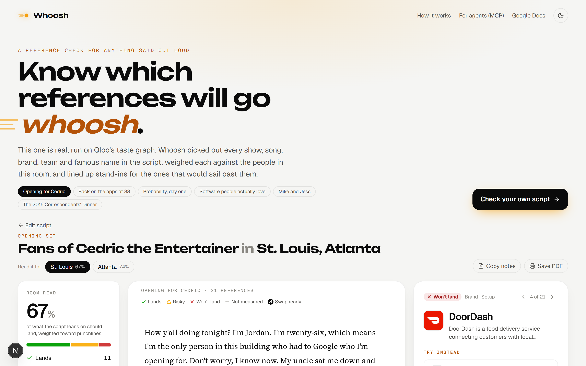
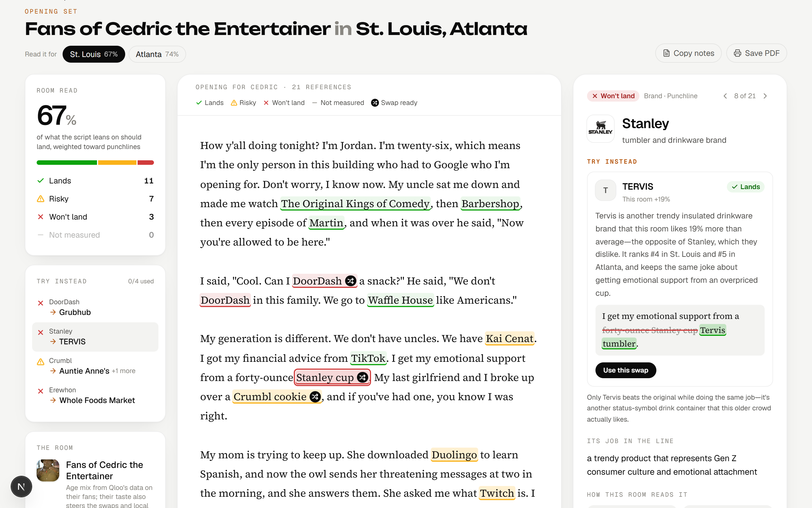
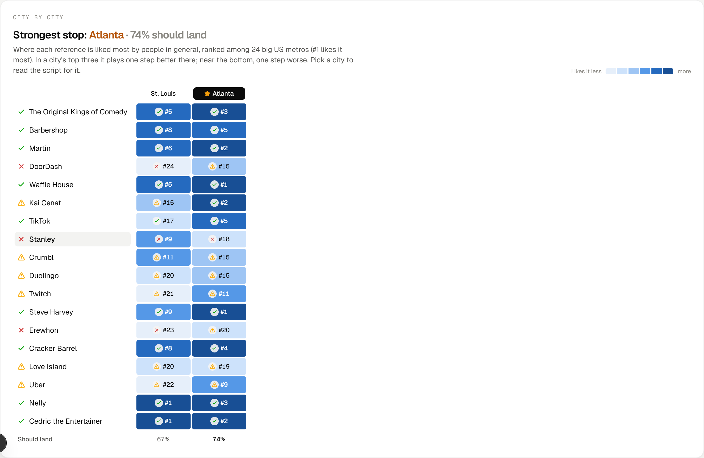

# Whoosh

**Find the references that will fly over the room, before you're standing in front of it.**

A 26-year-old comic is opening for Cedric the Entertainer in St. Louis. Her five minutes lean on DoorDash, a Stanley cup, Erewhon and Love Island. Most of the people in those seats are over 55. Some of those names will get a laugh, some will get a polite silence, and she won't know which until she's on stage.

Whoosh tells her first. It reads a script the way a writer would, finds every name it leans on (shows, songs, brands, teams, famous people, places), and checks each one against the people who'll actually be listening, using [Qloo](https://qloo.com)'s taste graph. The names that would sail past them come back with stand-ins that do the same work in the line and that this crowd knows and likes.

**Try it: https://whoosh-check.vercel.app.** The page opens on that comic's real check. Built for the Qloo Agentic Hackathon.



## Who it's for

Anyone who says things out loud to people they didn't pick: comics working a new city, best men at a wedding where half the guests are the bride's grandparents, professors whose game-show analogies are older than their students, keynote speakers flying into a different industry every week, ad writers with one script and six markets. Colleges once published a yearly list of things incoming freshmen had never heard of, so faculty would stop making references that died in the lecture hall. Whoosh does that for any room, on any script, in a few seconds.

## What happens to a script

1. **Claude reads it like a writer.** Every name gets pulled out with the exact words that carry it and the job it's doing in the line ("a dated boy band that dates the speaker", "a pricey grocery store as a punchline"). A song counts as its artist, a catchphrase as its show, "Central Perk" as *Friends*. Private people, generic nouns, and events or memes a taste graph can't hold are kept apart.
2. **Each name is pinned to the right Qloo entity.** An exact match in the expected category is taken as is. Anything less certain (a restaurant that happens to be called "Canvas") goes back to Claude, which can choose a candidate, accept an honest stand-in, or decline; an unchecked name beats a confident measurement of the wrong thing.
3. **Qloo measures the room.** For every entity: how alive it is in culture today (its popularity percentile), how each of Qloo's six age groups likes it compared with the average adult, weighted by who's in this room, and how each city on the tour ranks it against two dozen big US metros.
4. **Code makes the call, city by city.** Plain rules turn those numbers into *lands*, *risky* or *won't land*. Qloo's age index says how much a group enjoys something, not whether it has heard of it, so a household name this crowd is cool on is *risky* (they'll get it, it just isn't theirs), and *won't land* is saved for names that are faded or niche and that the room doesn't care about. A name in a city's top three plays one step better there, and one near the bottom plays one step worse, unless everybody knows it anyway.
5. **Stand-ins get hunted down.** For each weak name, a Claude agent works Qloo with its own tools (search for similar things this crowd likes, look up a specific idea, narrow by genre tags, measure candidates exactly the way the original was measured) and only offers ones that beat the original for this room. It rewrites just the words that carry the reference. It leaves a name alone when the joke is that this room wouldn't know it, and it never changes a fact (who hosted the show, who said the quote).

Claude does the reading, the matching and the writing. Every number on the page comes from Qloo, through code. [docs/ARCHITECTURE.md](docs/ARCHITECTURE.md) has the details.

## On the page

- **The script, marked up.** Each name is tinted by its call, with a small mark where a stand-in is ready. Click one for the evidence.
- **Try instead.** The stand-ins come first in the details. Take one and the line changes in place as a tracked change; the room score moves with it.
- **The numbers behind each call.** Presence today, this room against the average adult, each age group's lean, each city's rank.
- **A room made of someone's fans.** Pick a comedian, band, show or podcast, and the room becomes their audience: Qloo's age profile for those fans sets the mix, their taste steers the stand-ins and local suggestions, and the cities where they're concentrated are offered for the tour.
- **The tour.** Flip the script between cities and watch the marks change, see every name against every stop, and find the strongest one.
- **Local material.** Places and artists this crowd favors in each city, for an opener or crowd work.
- **Claude's own guess.** Before it sees any data, Claude calls each name blind; the page shows where its guess and Qloo's numbers disagree.
- **Take-aways.** Copy the revised script, copy notes as Markdown, or print them.

Light and dark themes, and it works on a phone.





## How well it works

We tested on scripts nobody wrote for this project: 21 pieces that were actually performed (stretches of presidential correspondents' dinner speeches with the transcripts' laughter marks, commencement speeches and TED talks, stand-up excerpts checked against each comedian's own fans, and published wedding toasts). The texts are third-party, so they stay out of this repository.

- **Finding the names.** Against references marked blind by a separate annotator: 89.1% recall and 98.6% precision overall, and 240 of 264 (90.9%) of the kinds of things Whoosh measures. Most misses were things it deliberately leaves alone (politicians, events, eras).
- **Does "lands" mean laughs?** On the transcripts with laughter marks (95 measured references), lines whose name we called *lands* got a laugh 68% of the time, *risky* 58%, *won't land* 25%. It's a small sample, so read it as a sanity check rather than proof.
- **Is Qloo telling us anything a model doesn't know?** Claude's blind call and Qloo's numbers disagreed on 78 of 227 names, about one in three, and Claude called 6 of the 14 names Qloo marks as misses safe.
- **Awkward input.** 10 of 10 stress cases pass: instructions planted in the script, brand words used as ordinary words, song lyrics, a Turkish script, a script with no references, private names, fictional characters, emoji and HTML, politicians.
- **The code.** 96 unit tests, including the swap agent run against a scripted model and the Google Docs script run against a stand-in for Apps Script.

## For agents (MCP)

Whoosh is an MCP server too, over Streamable HTTP at `/api/mcp`, so an agent that drafts toasts, talks or ad copy can test its own work on the crowd it's meant for.

| Tool | What it's for |
|---|---|
| `check_script` | Every name in a script, called for a room and for each city, with the room score. Quick by default; `find_swaps: true` adds the stand-in search. |
| `compare_rooms` | One script against up to four rooms at once, and the names they disagree on. Reads the script only once. |
| `find_swaps` | The stand-in agent for one name in a script. |
| `score_reference` | One name, one room, no script: presence, room index, city ranks, the call. No model involved. |
| `fans_of` | Who a performer's fans are by Qloo's measure: age mix and the cities where they cluster. |
| `crowd_hooks` | Places and artists a crowd favors in one city. |
| `list_rooms` | The preset rooms and their age mixes. |

```bash
claude mcp add --transport http whoosh https://whoosh-check.vercel.app/api/mcp
```

Other clients can point at the same URL, or reach it through `npx -y mcp-remote https://whoosh-check.vercel.app/api/mcp` if they only speak stdio.

## In Google Docs

Speeches get written in documents, so there's a Docs sidebar ([`addons/google-docs`](addons/google-docs)). It colors each name in the document by its call, jumps to a name when you click it, and writes the stand-in you pick straight into the text, touching only the words that change. It's a script attached to a document rather than a Marketplace add-on, so getting it is one click: [copy the template document](https://docs.google.com/document/d/1OQeF2oHjghGVVpGxqt1NRmLSRXUbn5_6-zBSXhIcIYE/copy), then open **Whoosh → Check this room**.

## Running it yourself

Node.js 20 or later.

```bash
npm install
cp .env.example .env.local   # keys go here; the built-in examples need only the Qloo key
npm run dev                  # http://localhost:3000
```

| Variable | What it does |
|---|---|
| `QLOO_API_KEY` | The hackathon Qloo key (it only works against `https://hackathon.api.qloo.com`). |
| `ANTHROPIC_API_KEY` | For checking your own scripts. The examples replay recorded model output and run without it. |
| `ANTHROPIC_BASE_URL` | Optional: an Anthropic-compatible endpoint in place of the Claude API. |
| `LLM_MODEL` | Optional: the model behind every step. Default `claude-opus-5-5`. |
| `KV_REST_API_URL`, `KV_REST_API_TOKEN` | Optional: an Upstash Redis store, so the Qloo cache is shared and survives deploys, and the rate limits hold across instances. |
| `LIVE_PER_IP_PER_HOUR`, `LIVE_PER_DAY` | Optional: how many live checks to allow (default 8 an hour per visitor, 150 a day). Examples don't count. |

Keys are read on the server only.

```bash
npm test                                              # unit tests
npm run typecheck
npx tsx evals/extraction/run.ts <run-dir> [effort]    # extract from the gold-set texts
npx tsx evals/extraction/score.ts <run-dir>           # score that run against the gold set
npx tsx --env-file=.env.local evals/gut/compare.ts    # Claude's blind call vs. Qloo on the examples
npx tsx scripts/record-example.ts <sample-id>         # record an example's model output for replay
```

## What's where

```
src/app/            pages (the site, /addon for Docs) and API routes (/api/analyze, /api/swap, /api/cities, /api/performers, /api/mcp)
src/components/     the interface
src/lib/analysis/   reading, matching, measuring, calling, the stand-in agent and its tools
src/lib/audience/   preset rooms, performers' fans, age-mix math
src/lib/qloo/       Qloo client: pacing, retries, caching, response shapes
src/lib/ui/         tracked changes, room score, city tables, exported notes
src/lib/geo/        city lookup
src/content/        example scripts and their recorded model output
evals/              gold set and scorers: extraction, blind calls, real-world scripts, stress cases
scripts/            data builds and example recording
addons/google-docs/ the Docs sidebar (Apps Script)
```

## Data and privacy

- Qloo describes audiences in aggregate. Whoosh sends Qloo names, cities and age mixes, never anything about a person, and every result is about a crowd's leanings, never a prediction about someone in it.
- Qloo responses live in a server-side cache only; none are committed. The examples' recordings hold model output and names, and every run measures those names again.
- City coordinates come from [GeoNames](https://www.geonames.org) ([CC BY 4.0](https://creativecommons.org/licenses/by/4.0/)), built by `scripts/build_cities.py`.
- Examples 01–04 and 07 were written for this project. Example 05 is an excerpt of a President's public remarks (a U.S. Government work, in the public domain). Example 06 is a set of anonymous one-liners that circulate freely online.

## License

[MIT](LICENSE)
